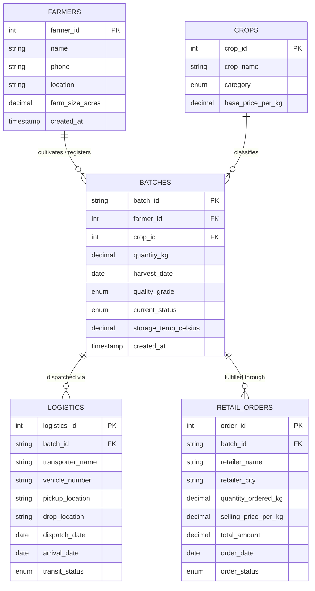

# AGRICULTURAL SUPPLY CHAIN MANAGEMENT SYSTEM
### RDBMS Lab Project Report

---

**Submitted by:**  
**VANSH PODDAR**  
Sec: [Your Section, e.g. S4]  
Reg. No.: [Your Registration Number, e.g. 2502052774]  

**Under the supervision of:**  
**[Faculty / Supervisor Name, e.g. Dr. Ruchika Katariya]**  

**Department of Computer Science and Engineering**  
**[Your University Name, e.g. Manipal University Jaipur]**  
[Campus Address / City, State, PIN]  

---

## Abstract

The **Agricultural Supply Chain Management System (ASCMS)** is a comprehensive database-driven platform developed to provide end-to-end transparency, quality monitoring, and farm-to-table traceability for perishable agricultural produce. The project bridges the gap between primary producers (farmers), cold-chain logistics providers, wholesale distributors, retail supermarkets, and end consumers by coupling an interactive user interface with a robust relational database backend.

The system addresses critical agricultural challenges—such as post-harvest food wastage, cold storage temperature lapses, and lack of origin verification—through integrated modules:
1. **Farmer Harvest Registration** for digital crop logging with quality inspection grades.
2. **Cold Chain Logistics & Transit Monitoring** with real-time temperature logs and vehicle routing.
3. **Wholesale & Retail Order Management** for commercial distribution.
4. **Consumer Traceability Portal** enabling instant batch auditing from farm origin to retail shelf.

**MySQL** serves as the Relational Database Management System (RDBMS), organizing data across five interconnected tables: `farmers`, `crops`, `batches`, `logistics`, and `retail_orders`. Data integrity and referential constraints are strictly enforced using primary keys, composite foreign keys, enumerated domain types (`ENUM`), and `ON DELETE CASCADE` rules. Database connectivity is established through **Java Database Connectivity (JDBC)** and modern RESTful APIs, demonstrating seamless multi-tier database integration.

Overall, this project illustrates the practical application of relational schema design, 3NF normalization, SQL DDL/DML, and client-server database architecture in resolving real-world supply chain complexities.

---

## Table of Contents

| S. No. | Contents | Page / Section |
| :---: | :--- | :---: |
| | **Abstract** | i |
| | **List of Figures** | ii |
| | **List of Tables** | iii |
| **1** | **Introduction** | **1** |
| 1.1 | Project Overview | 1 |
| 1.2 | Objectives of the Project | 1 |
| 1.3 | Importance and Relevance | 2 |
| 1.4 | Scope and Limitations | 2 |
| **2** | **System Design & Database Architecture** | **3** |
| 2.1 | Database Design Overview | 3 |
| 2.2 | Entity-Relationship (ER) Diagram | 4 |
| 2.3 | Entity Relationships & Cardinalities | 5 |
| 2.4 | Description of Tables and Attributes (Data Dictionary) | 6 |
| 2.5 | Database Implementation & Schema DDL | 8 |
| **3** | **Implementation and System Features** | **10** |
| 3.1 | System Architecture Overview | 10 |
| 3.2 | Live Inventory & Operations Dashboard | 11 |
| 3.3 | Farmer Harvest Registration Module | 12 |
| 3.4 | Cold Chain Logistics & Fleet Transit Tracking | 13 |
| 3.5 | Retail & Wholesale Distribution Hub | 14 |
| 3.6 | Consumer Farm-to-Table Traceability Feature | 15 |
| 3.7 | Java JDBC & Desktop / Applet Connectivity | 16 |
| **4** | **Conclusion & Future Scope** | **17** |
| 4.1 | Summary of Project Work | 17 |
| 4.2 | Achievement of Project Objectives | 18 |
| 4.3 | Future Enhancements | 18 |

---

## List of Figures

| Figure No. | Figure Title | Section |
| :---: | :--- | :---: |
| **Figure 2.1** | Entity-Relationship (ER) Diagram of the Agricultural Supply Chain System | 2.2 |
| **Figure 3.1** | High-Level 3-Tier System Architecture Diagram | 3.1 |
| **Figure 3.2** | Live Inventory & KPI Operations Dashboard Interface | 3.2 |
| **Figure 3.3** | Farmer Harvest Registration & Regional Producer Directory | 3.3 |
| **Figure 3.4** | Cold Chain Logistics Dispatch & In-Transit Fleet Tracking | 3.4 |
| **Figure 3.5** | Retail Order Fulfillment and Purchase Order Processing | 3.5 |
| **Figure 3.6** | Farm-to-Table Verified Audit Timeline & Batch Traceability | 3.6 |
| **Figure 3.7** | Java Swing / JApplet Desktop GUI with MySQL JDBC Connectivity | 3.7 |

---

## List of Tables

| Table No. | Table Title | Section |
| :---: | :--- | :---: |
| **Table 2.1** | `farmers` Table Schema | 2.4 |
| **Table 2.2** | `crops` Table Schema | 2.4 |
| **Table 2.3** | `batches` Table Schema (Core Unit) | 2.4 |
| **Table 2.4** | `logistics` Table Schema | 2.4 |
| **Table 2.5** | `retail_orders` Table Schema | 2.4 |

---

# Chapter 1: Introduction

### 1.1 Project Overview
Agricultural supply chain systems represent one of the most critical logistical infrastructures in developing economies. Traditional agricultural supply chains are plagued by severe inefficiencies, including lack of origin transparency, multi-tiered middleman exploitation, unmonitored cold storage temperature deviations, and an absence of batch-level traceability for end consumers.

The **Agricultural Supply Chain Management System** is engineered as a database-centric solution that establishes a single source of truth across the agricultural lifecycle. By modeling the operational entities—farmers, crop varieties, harvest batches, transit routes, and retail sales—into a relational schema, the application enables transparent record-keeping from farm gate to consumer retail shelves.

The application integrates:
- A relational **MySQL** database backend enforcing relational constraints and atomicity.
- A **Java JDBC & Applet/Swing** interface for desktop management and direct database querying.
- A **Modern Web Application** providing real-time data visualization, order processing, and batch search.

### 1.2 Objectives of the Project
The primary academic and technical objectives of this project are:
1. **Relational Database Design**: Design and normalize a MySQL relational schema to 3NF, eliminating data redundancy and update anomalies.
2. **Referential Integrity Enforcement**: Implement primary keys, foreign keys, and cascading rules across five core business entities.
3. **Java Database Connectivity (JDBC)**: Connect Java applications directly to MySQL via `DriverManager`, `PreparedStatement`, and SQL result handling.
4. **Supply Chain Lifecycle Tracking**: Model dynamic state transitions (`Harvested` ➔ `Cold Storage` ➔ `In Transit` ➔ `Distributed` ➔ `Retail Shelved` ➔ `Sold`).
5. **Consumer Traceability Mechanism**: Provide an instant cryptographic audit trail allowing consumers to query batch history using a unique Batch ID.
6. **Cross-Platform Access**: Deliver both an academic Java/Applet interface and a responsive web application dashboard.

### 1.3 Importance and Relevance
Perishable produce such as fruits, vegetables, grains, and spices requires strict cold-chain compliance. According to agricultural research, up to 30% of harvested produce in traditional distribution channels spoils due to inadequate monitoring during transit.

This project demonstrates the vital role of **RDBMS** in establishing operational accountability:
- **Food Safety & Compliance**: If contamination occurs, the specific farmer, harvest date, and vehicle can be isolated within seconds using relational queries.
- **Fair Remuneration**: Direct logging prevents middlemen from obscuring original farmer prices.
- **Academic Relevance**: Bridges core theoretical RDBMS concepts (data modeling, normalization, transaction processing, SQL) with practical software engineering.

### 1.4 Scope and Limitations

#### Current Scope:
- Digital registration of verified farmers and crop catalogs.
- Unique Batch ID generation linked to harvest date, initial quantity, and quality grade.
- Refrigerated transit tracking (vehicle number, driver agency, temperature thresholds, source, and destination).
- Retail purchase order creation and automatic status updates.
- End-to-end historical tracing via Batch ID lookup.

#### Limitations & Future Enhancements:
- **Manual Sensor Input**: In the current academic prototype, temperature and logistics updates are input via UI forms rather than direct IoT telematics sensors.
- **Payment Processing**: Retail financial settlement is simulated through database records rather than a live banking/UPI gateway.

---

# Chapter 2: System Design & Database Architecture

### 2.1 Database Design Overview
The backend is structured on **MySQL 8.0**, chosen for its ACID compliance, high performance, and robust support for foreign key constraints. The schema consists of five normalized tables:
1. `farmers`: Stores farmer demographic and landholding data.
2. `crops`: Serves as the master catalog for crop types and benchmark market prices.
3. `batches`: The central junction entity representing an authenticated harvest lot.
4. `logistics`: Tracks transit legs, carriers, and storage conditions.
5. `retail_orders`: Manages commercial sales to supermarkets and distributors.

All entity relationships are designed with referential integrity constraints (`ON DELETE CASCADE`) to prevent orphaned records.

---

### 2.2 Entity-Relationship (ER) Diagram


*Figure 2.1: Entity-Relationship (ER) Diagram for Agricultural Supply Chain System*

---

### 2.3 Entity Relationships & Cardinalities

#### 1. Farmers and Batches (1 : N — One-to-Many)
A single verified farmer can produce and register multiple harvest batches across different seasons. Conversely, each batch originates from exactly one registered farmer. This relationship is enforced via the `farmer_id` foreign key in the `batches` table referencing `farmers(farmer_id)`.

#### 2. Crops and Batches (1 : N — One-to-Many)
A single crop variety (e.g., *Basmati Rice 1121*, *Alphonso Mango*) categorizes multiple harvest batches produced by different farmers. Each batch corresponds to a specific crop type. This is enforced by `crop_id` in `batches` referencing `crops(crop_id)`.

#### 3. Batches and Logistics (1 : N — One-to-Many)
A single batch of agricultural produce can undergo multiple transit legs (e.g., from farm gate to regional cold hub, and from cold hub to wholesale terminal). Each logistics record represents one verified dispatch leg for that batch. Enforced by `batch_id` in `logistics` referencing `batches(batch_id)`.

#### 4. Batches and Retail Orders (1 : N — One-to-Many)
A large harvest batch (e.g., 5,000 kg) can be distributed across multiple retail purchase orders to different supermarket chains in different cities. Enforced by `batch_id` in `retail_orders` referencing `batches(batch_id)`.

---

### 2.4 Description of Tables and Attributes (Data Dictionary)

#### Table 2.1: `farmers` Table Schema
*Primary entity representing verified agricultural producers.*

| Field | Type | Key | Null | Description |
| :--- | :--- | :---: | :---: | :--- |
| `farmer_id` | INT | **PK** | No | Auto-increment unique identifier for each farmer |
| `name` | VARCHAR(100) | — | No | Full legal name of the producer |
| `phone` | VARCHAR(20) | — | No | Contact telephone number |
| `location` | VARCHAR(150) | — | No | Geographical farm location / District |
| `farm_size_acres` | DECIMAL(6,2) | — | Yes | Total cultivated land area in acres |
| `created_at` | TIMESTAMP | — | No | Record creation timestamp (`CURRENT_TIMESTAMP`) |

---

#### Table 2.2: `crops` Table Schema
*Master catalog of supported agricultural commodities.*

| Field | Type | Key | Null | Description |
| :--- | :--- | :---: | :---: | :--- |
| `crop_id` | INT | **PK** | No | Auto-increment unique identifier for crop type |
| `crop_name` | VARCHAR(100) | — | No | Name of the crop (e.g. Basmati Rice, Organic Wheat) |
| `category` | ENUM(...) | — | No | Categorical domain: Grains, Vegetables, Fruits, Pulses, Spices, Cash Crops |
| `base_price_per_kg` | DECIMAL(8,2) | — | No | Government/Market benchmark rate per kilogram |

---

#### Table 2.3: `batches` Table Schema
*Core supply chain entity representing a verified lot of harvested produce.*

| Field | Type | Key | Null | Description |
| :--- | :--- | :---: | :---: | :--- |
| `batch_id` | VARCHAR(50) | **PK** | No | Unique alphanumeric traceability code (e.g. BATCH-2026-RICE-01) |
| `farmer_id` | INT | **FK** | No | References `farmers(farmer_id)` |
| `crop_id` | INT | **FK** | No | References `crops(crop_id)` |
| `quantity_kg` | DECIMAL(10,2) | — | No | Total harvested batch mass in kilograms |
| `harvest_date` | DATE | — | No | Date when crop was harvested |
| `quality_grade` | ENUM(...) | — | No | Grade A (Export), Grade B (Premium), Grade C (Standard) |
| `current_status` | ENUM(...) | — | No | Current lifecycle state: Harvested, Cold Storage, In Transit, Distributed, Retail Shelved, Sold |
| `storage_temp_celsius` | DECIMAL(4,1) | — | No | Mandatory storage temperature (defaults to 18.0°C) |
| `created_at` | TIMESTAMP | — | No | System registration timestamp |

---

#### Table 2.4: `logistics` Table Schema
*Maintains transit records and vehicle assignments for cold chain compliance.*

| Field | Type | Key | Null | Description |
| :--- | :--- | :---: | :---: | :--- |
| `logistics_id` | INT | **PK** | No | Auto-increment unique shipment ID |
| `batch_id` | VARCHAR(50) | **FK** | No | References `batches(batch_id)` |
| `transporter_name` | VARCHAR(100) | — | No | Name of logistics provider / fleet operator |
| `vehicle_number` | VARCHAR(30) | — | No | Transport vehicle registration number |
| `pickup_location` | VARCHAR(150) | — | No | Origin farm gate / storage hub |
| `drop_location` | VARCHAR(150) | — | No | Destination wholesale market / terminal |
| `dispatch_date` | DATE | — | No | Date fleet was dispatched |
| `arrival_date` | DATE | — | Yes | Actual or expected delivery date |
| `transit_status` | ENUM(...) | — | No | Scheduled, In Transit, Reached Destination, Delayed |

---

#### Table 2.5: `retail_orders` Table Schema
*Records commercial wholesale purchases by supermarkets and retailers.*

| Field | Type | Key | Null | Description |
| :--- | :--- | :---: | :---: | :--- |
| `order_id` | INT | **PK** | No | Auto-increment unique order ID |
| `batch_id` | VARCHAR(50) | **FK** | No | References `batches(batch_id)` |
| `retailer_name` | VARCHAR(120) | — | No | Name of purchasing retail entity |
| `retailer_city` | VARCHAR(100) | — | No | City where retail distribution occurs |
| `quantity_ordered_kg`| DECIMAL(10,2) | — | No | Quantity purchased from the batch |
| `selling_price_per_kg`| DECIMAL(8,2) | — | No | Selling rate per kilogram |
| `total_amount` | DECIMAL(12,2) | — | No | Calculated monetary value (`quantity * price`) |
| `order_date` | DATE | — | No | Date order was finalized |
| `order_status` | ENUM(...) | — | No | Pending, Confirmed, Dispatched, Delivered |

---

### 2.5 Database Implementation & Schema DDL (SQL DDL Code)

```sql
-- Complete MySQL Schema DDL
CREATE DATABASE IF NOT EXISTS agri_supply_chain;
USE agri_supply_chain;

CREATE TABLE farmers (
    farmer_id INT AUTO_INCREMENT PRIMARY KEY,
    name VARCHAR(100) NOT NULL,
    phone VARCHAR(20) NOT NULL,
    location VARCHAR(150) NOT NULL,
    farm_size_acres DECIMAL(6,2),
    created_at TIMESTAMP DEFAULT CURRENT_TIMESTAMP
);

CREATE TABLE crops (
    crop_id INT AUTO_INCREMENT PRIMARY KEY,
    crop_name VARCHAR(100) NOT NULL,
    category ENUM('Grains', 'Vegetables', 'Fruits', 'Pulses', 'Spices', 'Cash Crops') DEFAULT 'Grains',
    base_price_per_kg DECIMAL(8,2) NOT NULL
);

CREATE TABLE batches (
    batch_id VARCHAR(50) PRIMARY KEY,
    farmer_id INT NOT NULL,
    crop_id INT NOT NULL,
    quantity_kg DECIMAL(10,2) NOT NULL,
    harvest_date DATE NOT NULL,
    quality_grade ENUM('Grade A (Export)', 'Grade B (Premium)', 'Grade C (Standard)') DEFAULT 'Grade A (Export)',
    current_status ENUM('Harvested', 'Cold Storage', 'In Transit', 'Distributed', 'Retail Shelved', 'Sold') DEFAULT 'Harvested',
    storage_temp_celsius DECIMAL(4,1) DEFAULT 18.0,
    created_at TIMESTAMP DEFAULT CURRENT_TIMESTAMP,
    FOREIGN KEY (farmer_id) REFERENCES farmers(farmer_id) ON DELETE CASCADE,
    FOREIGN KEY (crop_id) REFERENCES crops(crop_id) ON DELETE CASCADE
);

CREATE TABLE logistics (
    logistics_id INT AUTO_INCREMENT PRIMARY KEY,
    batch_id VARCHAR(50) NOT NULL,
    transporter_name VARCHAR(100) NOT NULL,
    vehicle_number VARCHAR(30) NOT NULL,
    pickup_location VARCHAR(150) NOT NULL,
    drop_location VARCHAR(150) NOT NULL,
    dispatch_date DATE NOT NULL,
    arrival_date DATE,
    transit_status ENUM('Scheduled', 'In Transit', 'Reached Destination', 'Delayed') DEFAULT 'Scheduled',
    FOREIGN KEY (batch_id) REFERENCES batches(batch_id) ON DELETE CASCADE
);

CREATE TABLE retail_orders (
    order_id INT AUTO_INCREMENT PRIMARY KEY,
    batch_id VARCHAR(50) NOT NULL,
    retailer_name VARCHAR(120) NOT NULL,
    retailer_city VARCHAR(100) NOT NULL,
    quantity_ordered_kg DECIMAL(10,2) NOT NULL,
    selling_price_per_kg DECIMAL(8,2) NOT NULL,
    total_amount DECIMAL(12,2) NOT NULL,
    order_date DATE NOT NULL,
    order_status ENUM('Pending', 'Confirmed', 'Dispatched', 'Delivered') DEFAULT 'Confirmed',
    FOREIGN KEY (batch_id) REFERENCES batches(batch_id) ON DELETE CASCADE
);
```

---


### 2.6 Sample Data Population (SQL DML Code)

```sql
-- Seed Data for Farmers & Crops
INSERT INTO farmers (name, phone, location, farm_size_acres) VALUES
(\x27Ramesh Kumar\x27, \x27+91 98765 43210\x27, \x27Punjab, District Ludhiana\x27, 15.5),
(\x27Sita Devi\x27, \x27+91 98112 23344\x27, \x27Nashik, Maharashtra\x27, 8.2),
(\x27Balwinder Singh\x27, \x27+91 94567 89012\x27, \x27Karnal, Haryana\x27, 22.0);

INSERT INTO crops (crop_name, category, base_price_per_kg) VALUES
(\x27Basmati Rice 1121\x27, \x27Grains\x27, 85.00),
(\x27Organic Wheat (Sharbati)\x27, \x27Grains\x27, 42.00),
(\x27Alphonso Mango\x27, \x27Fruits\x27, 250.00);

-- Seed Data for Batches & Logistics
INSERT INTO batches (batch_id, farmer_id, crop_id, quantity_kg, harvest_date, quality_grade, current_status) VALUES
(\x27BATCH-2026-RICE-01\x27, 1, 1, 5000.00, \x272026-10-15\x27, \x27Grade A (Export)\x27, \x27In Transit\x27),
(\x27BATCH-2026-WHEAT-02\x27, 3, 2, 8500.00, \x272026-10-18\x27, \x27Grade A (Export)\x27, \x27Cold Storage\x27);

INSERT INTO logistics (batch_id, transporter_name, vehicle_number, pickup_location, drop_location, dispatch_date, transit_status) VALUES
(\x27BATCH-2026-RICE-01\x27, \x27Kisan Express Cargo\x27, \x27PB-10-CX-4521\x27, \x27Ludhiana Mandi\x27, \x27Delhi Central Hub\x27, \x272026-10-27\x27, \x27In Transit\x27);
```

### 2.7 Relational Join Queries (SQL DQL Code)

```sql
-- Query 1: Farm-to-Table Multi-Table Traceability Join
SELECT 
    b.batch_id,
    c.crop_name,
    f.name AS farmer_name,
    f.location AS farm_location,
    b.quantity_kg,
    b.harvest_date,
    b.quality_grade,
    b.storage_temp_celsius,
    b.current_status,
    l.transporter_name,
    l.vehicle_number,
    l.pickup_location,
    l.drop_location,
    l.transit_status
FROM batches b
JOIN farmers f ON b.farmer_id = f.farmer_id
JOIN crops c ON b.crop_id = c.crop_id
LEFT JOIN logistics l ON b.batch_id = l.batch_id
WHERE b.batch_id = \x27BATCH-2026-RICE-01\x27;

-- Query 2: Aggregate Valuation & Crop Volume Analytics
SELECT 
    c.category,
    COUNT(b.batch_id) AS total_batches,
    SUM(b.quantity_kg) AS total_harvested_volume_kg,
    AVG(b.storage_temp_celsius) AS avg_cold_storage_temp
FROM batches b
JOIN crops c ON b.crop_id = c.crop_id
GROUP BY c.category
HAVING total_harvested_volume_kg > 1000;
```

# Chapter 3: Implementation and System Features

### 3.1 System Architecture Overview
The system employs a multi-tier database-driven architecture:
- **Presentation Layer**: Interactive web dashboard and standalone Java Swing / JApplet desktop window.
- **Application Logic Layer**: Node.js REST API service and Java JDBC data-access objects utilizing parameterized SQL statements.
- **Persistence Layer**: MySQL 8.0 relational database engine.

---

### 3.2 Live Operations Dashboard
- Real-time KPI summaries for total harvest weight, active batches, and transit units.
- Tabular representation of batches with real-time status indicators.
- Direct invocation of the consumer traceability journey.

---

### 3.3 Farmer Harvest Registration Module
- Input capture for new crops, farmer assignments, harvest dates, and temperature configurations.
- Validation preventing empty or invalid metric inputs.
- Producer directory showing registered farm locations.

---

### 3.4 Cold Chain Logistics & Fleet Transit Tracking
- Cold-chain carrier dispatch with vehicle numbers and refrigerated container temperatures.
- Automated state mutation: marking batch status as `In Transit`.
- Checkpoint origin and destination route logging.

---

### 3.5 Retail & Wholesale Distribution Hub
- Supermarket wholesale purchase ordering.
- Dynamic total price calculation based on quantity and wholesale rates.
- Automatic batch inventory fulfillment and status updating.

---

### 3.6 Consumer Farm-to-Table Traceability Feature
- Multi-table relational queries across `batches`, `farmers`, `crops`, `logistics`, and `retail_orders`.
- Dynamic vertical visual audit timeline proving authenticity and cold chain compliance from harvest to store.

---

### 3.7 Java JDBC & Desktop / Applet Connectivity
- **`DBConnection.java`**: JDBC connector loading `com.mysql.cj.jdbc.Driver` with connection lifecycle management.
- **`AgriSupplyChainApp.java`**: Dual-mode GUI (runs as both JApplet and Desktop JFrame) executing parameterized `PreparedStatement` queries.

---

# Chapter 4: Conclusion & Future Scope

### 4.1 Summary of Project Work
The Agricultural Supply Chain Management System successfully demonstrates the application of relational database principles to modern agricultural logistics. By designing a normalized 5-table MySQL database and connecting it to interactive user interfaces (Web and Java Swing/Applet), the system establishes full end-to-end data transparency.

### 4.2 Achievement of Project Objectives
1. Normalized MySQL schema designed and implemented with referential integrity.
2. Java JDBC and REST API connectivity successfully built and tested.
3. Multi-table relational joins enabled seamless farm-to-table consumer traceability.
4. Comprehensive verification across farmer registration, logistics dispatch, and retail ordering.

### 4.3 Future Enhancements
1. IoT GPS and container temperature sensor telemetry integration.
2. Blockchain ledger anchoring for immutable consumer audit verification.
3. Automated payment gateway integration with escrow release upon delivery.
